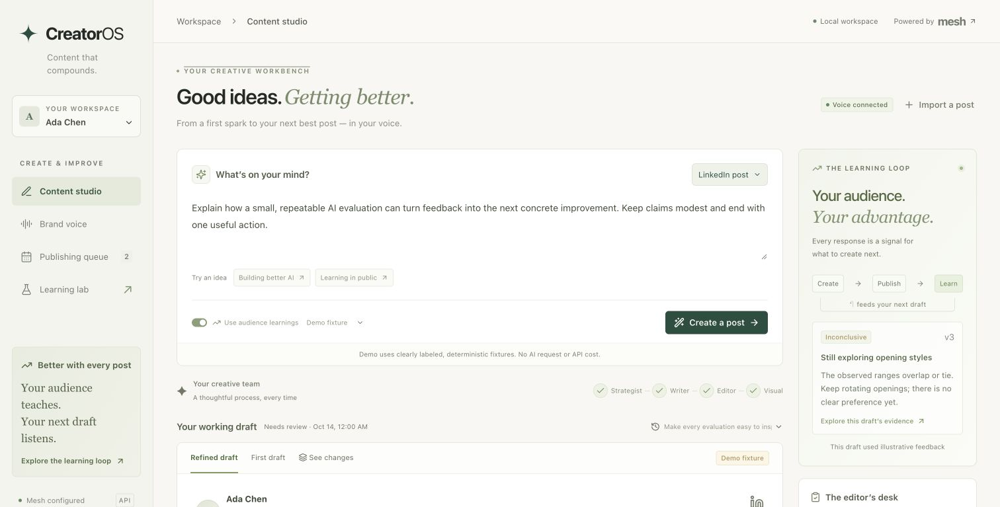
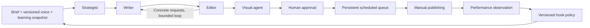

# CreatorOS

**A content studio that shows why the next post changed.**

CreatorOS helps LinkedIn technical creators turn a brief into an edited post and matching visual, queue it for publication, record engagement, and use that evidence to choose the next opening. The creator's voice stays anchored to multiple writing samples. Drafts, critiques, revisions, and learning decisions remain inspectable.

This is a local, single-user application built with FastAPI, React, SQLite, and LangGraph. Every live AI request—including brand extraction, editorial evaluation, and image generation—uses the mandatory [Mesh gateway](https://developers.meshapi.ai/). Demo content and synthetic engagement are visibly labeled.



[Watch the 75-second walkthrough](docs/demo.mp4). It is a captioned sequence of actual application screenshots using labeled fixtures, rather than a real-time generation recording. Independent live AI evidence is recorded separately in the evaluation reports.

## Quick start

Prerequisites: Python 3.11 or newer, Node.js 22 or newer, and a Mesh key for live AI generation. Fixture demos and deterministic checks work without paid AI calls.

```sh
python3 -m venv .venv
.venv/bin/python -m pip install -r requirements.txt -c constraints.txt
cp .env.example .env
npm --prefix frontend ci
npm --prefix frontend run build
.venv/bin/python -m uvicorn backend.creatoros.main:app --host 127.0.0.1 --port 8000
```

Open **http://127.0.0.1:8000**. Enter your Mesh key in the local `.env` before running live generation. Never paste it into a brief, commit it, or put it in frontend configuration.

```dotenv
MESH_API_KEY=rsk_your_key_here
MESH_BASE_URL=https://api.meshapi.ai/v1
MESH_CHAT_MODEL=openai/gpt-4o-mini
MESH_IMAGE_MODEL=openai/gpt-image-1-mini
CREATOROS_DATA_DIR=./data
CREATOROS_SEED_DEMO=true
```

Model availability and credit balance depend on the connected Mesh account. If a live request fails, the application preserves the error and completed work; synthetic output is never silently substituted for a failed paid call. The backend rejects an AI base URL outside Mesh.

For frontend development, run the backend command above and `npm --prefix frontend run dev` in another terminal. Open **http://127.0.0.1:5173**; Vite proxies API and asset requests to the backend. The production backend serves the built frontend from `frontend/dist`.

## What to try

1. **Brand:** inspect the two labeled demonstration brands, or create a brand and provide at least three distinct writing samples. Extract a profile that cites those samples.
2. **Studio:** enter a brief, follow agent progress, and compare the original draft with the revision. Inspect the editor's concrete requests and the evidence behind the strategy.
3. **Queue:** generate a matching visual, approve the post, and schedule it. When due, it becomes ready to publish. Download the assets and mark it published after posting manually.
4. **Learning:** record impressions, reactions, comments, and reposts for a consistent observation window. Recompute the learning snapshot and generate another post to see how the chosen opening changes.

The seeded Ada and Milo brands, their posts, and their engagement are authored demonstrations. The working local installation also contains **eight authentic, source-attributed LinkedIn posts** from the creator's profile, with a voice profile extracted through Mesh. Those samples and the local database remain under ignored `data/`; they are not distributed with the repository.

The authenticated LinkedIn capture includes visible cumulative impressions and engagement where displayed. Its observation windows are unspecified, so these counts are retained as reference observations and **are not entered as 24-hour or 7-day feedback**. Public fixtures and authentic creator data remain distinguishable. A fresh checkout starts with the labeled demonstration brands; import your own samples through Brand or [the sample-import CLI](scripts/import_samples.py).

## How the agents cooperate



| Agent | Distinct responsibility | Inspectable output |
|---|---|---|
| Strategist | Choose audience, angle, outline, and an opening consistent with the frozen policy | Strategy, selected hook, supporting feedback |
| Writer | Draft using the brief and learned voice; address editor requests | Preserved draft and revision versions |
| Editor | Review brief fulfillment, specificity, clarity, voice, and unsupported claims | Concrete requests and review results |
| Visual | Translate the final draft into a matching image brief | Image prompt and local generated asset |

LangGraph coordinates named steps and persistent checkpoints. The application preserves completed step artifacts so a page refresh or ordinary retry does not regenerate finished work. A bounded editorial loop prevents runaway spending; unresolved issues remain visible for human review.

Voice profiles and learning snapshots are separate. A run freezes the versions it uses, allowing the content strategy to adapt without silently replacing a creator's voice. Decision events record concise explanations and linked evidence rather than hidden model reasoning. Read [the design note](docs/DESIGN.md) for the data flow and tradeoffs.

## What “learning” means

CreatorOS learns one narrow, inspectable preference: **problem-first**, **outcome-first**, or **question-first** openings.

```text
meaningful interactions per 1,000 impressions
    = 1,000 × (comments + reposts) / impressions
```

Counts are pooled by hook within the same brand, provenance, and observation window. Missing or zero impressions are excluded. Before every hook has evidence, the policy rotates through hooks. Afterwards it usually selects the highest observed rate and tests another hook every fourth post. Ties rotate deterministically.

Every learning update creates a versioned snapshot with rates, sample sizes, evidence identifiers, and a readable explanation. The next strategist run consumes that snapshot. This is an explicit adaptive policy; it is not model fine-tuning. Small samples are marked **Early signal**, and no causal uplift is claimed.

## Evaluation and recorded results

The evaluation corpus contains **four held-out briefs × two demonstration voice profiles = eight pairs**, plus two feedback ablations and a deterministic policy-reversal check.

**Current recorded result (GPT-5.1 through Mesh):** 8/8 pairs completed after recovery, with mean scores **4.562 → 4.938 / 5**, **6 wins, 1 tie, and 1 regression**. Both blinded opening ablations and the feedback-reversal check passed. First-attempt completion was **4/8**; the report preserves those failures and the subsequent recovery. These are model-judged synthetic cases, not audience-engagement gains. See the [qualitative spot review](evals/REVIEW.md) for weaknesses the scores understate.

Run the reproducible, free fixture checks into a separate output directory:

```sh
.venv/bin/python scripts/evaluate.py --output /tmp/creatoros-fixture-evaluation
```

Run live generation and a separate, blinded Mesh judge (uses API credits):

```sh
MESH_CHAT_MODEL=openai/gpt-5.1 .venv/bin/python scripts/evaluate.py --live
```

The live judge scores **brief fulfillment, specificity, clarity, and brand fit** from 1–5. Candidate order is randomized with a fixed seed and original/revision labels are hidden. A separate blinded call classifies only each ablation's first visible sentence, retaining the exact sentence and its rationale. A metadata change alone cannot pass this live opening check.

Reports include completion rate, every case, paired deltas, wins, ties, losses, and regressions. Quality averages are conditional on successful generation and judging; failed cases remain in the completion denominator. Failed run stages, partial drafts, and sanitized validation diagnostics are retained. Raw rejected provider responses stay in ignored local diagnostic files. Images are excluded to keep evaluation spending focused.

**Recorded numbers and their provenance:** [evals/RESULTS.md](evals/RESULTS.md), [raw results](evals/results.json), and [CSV](evals/results.csv). Fixture results report mechanics such as changed drafts; their quality scores are deliberately null. The script never manufactures scores when a live request fails. A fixture pass is not evidence that AI writing quality improved.

The [initial eight-pair live benchmark](evals/history/initial/RESULTS.md) scored **4.469 → 4.906 / 5**, with **7 wins, 1 tie, and 0 losses**. A stricter follow-up exposed generation failures and weaknesses in opening classification; [that report is preserved too](evals/history/strict-first/RESULTS.md). The initial score does not certify the corrected build. Use the current primary report above to assess completion and the stricter checks, including any unresolved failures.

The [diagnostic mini-model run](evals/history/diagnostic-mini/RESULTS.md) retained three scored regressions and three generation failures. The [production model's first attempt](evals/history/production-first/RESULTS.md) completed four of eight pairs; the other four hit an unnecessarily restrictive 500-character limit on evidence notes. The limit now allows 1,200 characters while preserving content and rubric validation. These experiments changed model or validation configuration and are not a controlled comparison between model families.

Operational failures can be resumed from their frozen inputs and completed artifacts, without rerolling successful drafts or judgments:

```sh
MESH_CHAT_MODEL=openai/gpt-5.1 .venv/bin/python scripts/evaluate.py --live \
  --resume-results evals/history/production-first/results.json --output evals
```

Recovered reports retain first-attempt completion, previous errors, and separate recovery accounting. A completed but unsuccessful quality or opening comparison is retained as evidence, not retried until it passes.

The benchmark is small and synthetic, model judging is subjective, and engagement is not a causal experiment. Review at least two pairs manually before presenting live quality claims. Record disagreements and retain regressions.

```sh
.venv/bin/python -m pip install -r requirements-dev.txt -c constraints.txt
PYTEST_DISABLE_PLUGIN_AUTOLOAD=1 .venv/bin/python -m pytest
.venv/bin/python scripts/check_submission.py
npm --prefix frontend run build
```

`check_submission.py` inspects local syntax, manifests, Mesh configuration, evaluation files, and basic secret hygiene. It cannot certify a valid Mesh key, GitHub repository visibility, or organizer CI.

The separate [CreatorOS test workflow](.github/workflows/tests.yml) builds the frontend and runs regression and fixture checks without an API key or paid calls. It leaves the committed live reports intact. `constraints.txt` records the direct Python package versions exercised locally; the frontend uses its committed npm lockfile.

## API and persistence

The interactive API schema is available at **http://127.0.0.1:8000/docs**. Generation creates a run immediately; the frontend polls persisted progress. Brands, samples, posts, draft versions, feedback observations, snapshots, and decision events live in SQLite under `CREATOROS_DATA_DIR`. Generated images are local assets in the same data directory.

Scheduling is durable: store UTC timestamps, display local time, and transition due approved posts into a ready state. This release uses manual LinkedIn publication and manually entered engagement. It does not include an automatic LinkedIn publisher, authentication, multi-user isolation, or a production deployment configuration. Keep the local service bound to `127.0.0.1`.

## Submission

The challenge requires a **public GitHub repository** and the organizer's unchanged workflow at `.github/workflows/agent-arena-2026-checks.yml`.

Configure these GitHub repository secrets under **Settings → Secrets and variables → Actions**:

- `MESH_API_KEY`: the Mesh key used by your checks.
- `SUBMISSION_TOKEN`: the registration token from your submission dashboard.

Push the submission commit and verify its Actions result and dashboard status. Local checks do not prove that a repository has been published or the organizer's remote checks passed. The repository must contain source, dependency manifests, this README, [design decisions](docs/DESIGN.md), and actual [evaluation results](evals/RESULTS.md). The [submission handoff](docs/SUBMISSION.md) maps each requirement to evidence and lists the remaining publication steps. [Demo materials](docs/DEMO.md) include the captioned walkthrough and a longer recording storyboard.
