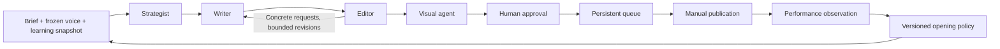

# CreatorOS

**A content studio that shows why the next post changed.**

[Demo](docs/demo.mp4) · [Evaluation](evals/fresh-recovered/RESULTS.md) · [Design](docs/DESIGN.md) · [Challenge requirements](requirement.md) · [Project CI](https://github.com/chatkausik/creatoros-content-studio/actions/workflows/tests.yml)

CreatorOS turns a brief into an edited LinkedIn post or newsletter, generates a matching visual, queues the approved piece, and uses recorded performance to guide the next opening. Its defining interaction is inspectable: **previous opening → feedback evidence → strategy decision → next opening**. Multiple writing samples anchor the creator's voice throughout the process.

FastAPI, React, SQLite, and LangGraph power a local, single-user application. Every live AI call—voice extraction, writing, editing, visual generation, and evaluation—routes through the mandatory [Mesh gateway](https://developers.meshapi.ai/). Demo output and simulated engagement are labeled separately.


The [90-second walkthrough](docs/demo.mp4) uses actual application screenshots and fictional demonstration records. It is a captioned screenshot sequence, not a real-time generation recording. [Live Mesh outputs and generated images](evals/UPGRADE_VALIDATION.md) are documented separately.

## What works today

| Capability | What you can inspect |
|---|---|
| Four cooperating agents | Strategist, writer, editor, and visual agent have distinct prompts and named LangGraph steps |
| Editorial refinement | Original text, concrete edit requests, revisions, and review history |
| Learned voice | A versioned profile extracted from multiple writing samples, with supporting quotes |
| Human control | Saved manual edits, rechecks, stale-review indicators, and explicit acknowledgement of unresolved concerns |
| Visual iteration | Matching images, regeneration feedback, retained variants, and renewed approval after changes |
| Two content formats | LinkedIn posts and developed newsletters, with copy and export controls |
| Persistent queue | Approved posts become ready when due; publication and confirmation are manual |
| Evidence-based adaptation | Comparable observations, frozen learning snapshots, continued exploration, and actual subsequent openings |
| Recoverable execution | Saved step artifacts, frozen run settings, failure diagnostics, and compatible retries |

The scheduler does not publish to LinkedIn or send email. Platform analytics are entered manually. Authentication, multi-user isolation, and production hosting are outside this release.

## Run locally

Prerequisites: **Python 3.11+** and **Node.js 22+**. Run these commands from the repository root. A Mesh key is needed only for live AI actions.

```sh
python3 -m venv .venv
.venv/bin/python -m pip install -r requirements.txt -c constraints.txt
cp .env.example .env
npm --prefix frontend ci
npm --prefix frontend run build
```

Before starting the backend, edit `.env`. For a free fixture demo, leave `MESH_API_KEY` empty and keep `CREATOROS_SEED_DEMO=true`. For live generation, supply your own key:

```dotenv
MESH_API_KEY=
MESH_BASE_URL=https://api.meshapi.ai/v1
MESH_CHAT_MODEL=openai/gpt-4o-mini
MESH_IMAGE_MODEL=openai/gpt-image-1-mini
CREATOROS_DATA_DIR=./data
CREATOROS_SEED_DEMO=true
```

```sh
.venv/bin/python -m uvicorn backend.creatoros.main:app --host 127.0.0.1 --port 8000
```

Open **http://127.0.0.1:8000**. Select **Demo fixture** in the generation/profile controls for actions without paid calls; live mode can be selected automatically when a key is configured. Demo text, reviews, and SVG visuals exercise the workflow without measuring AI quality. Restart the backend after changing `.env`.

Live generation offers **Configured model**, **Budget** (`openai/gpt-4o-mini`), and **Submission-tested** (`openai/gpt-5.1`) presets. “Submission-tested” identifies the model used in the recorded evaluation; it is not a quality guarantee. Model access and credits depend on your Mesh account. A failed live call preserves its error and completed work rather than substituting a fixture. The backend rejects an AI base URL outside Mesh.

Keep keys server-side in the ignored `.env`, and keep the service bound to `127.0.0.1`. The app has no authentication. For frontend development, leave the backend running and use `npm --prefix frontend run dev`; open **http://127.0.0.1:5173**. Vite proxies API and asset requests to the backend.

For an empty workspace, set `CREATOROS_SEED_DEMO=false` and choose a new `CREATOROS_DATA_DIR` before starting. Disabling seeding does not delete existing data.

## Try the complete loop

1. **Choose a voice.** Inspect the fictional Ada and Milo workspaces, or create a brand with at least three distinct writing samples. Live extraction creates a profile grounded in those samples.
2. **Create and refine.** Choose LinkedIn or newsletter, enter a brief, follow agent progress, and compare the draft with its revision. Make a manual edit and request a fresh review; previous reviews remain in history.
3. **Choose the visual.** Generate an image, provide regeneration feedback, or select a saved variant. Live regeneration is a new paid action. Retry of a saved failed request retains its request configuration and can reuse completed provider work.
4. **Approve and queue.** Resolve or explicitly acknowledge outstanding concerns, then schedule the post. When it is ready, publish it yourself and confirm publication in the app. The scheduler runs while the backend is running and checks overdue items after restart.
5. **Close the loop.** Enter engagement with its measurement time and observation window. Recompute learning, inspect the exact observations behind the snapshot, and generate another post to see the chosen opening in actual prose.

Generated LinkedIn drafts are validated as plain text up to **3,000 characters**. Generated newsletters require a subject, **400–700 words**, and at least three section headings; prompts also request a worked example, exercise, and trade-offs. Those semantic elements still need editorial review. Manual edits save a new version and make earlier checks stale; approval is a creator decision, not a guarantee that every brief constraint passed.

A fresh checkout contains only labeled demonstration data. The creator's working installation additionally has eight authentic, source-attributed LinkedIn samples, held privately under ignored `data/`. They are not bundled with the repo. Import your own samples through Brand or the [sample-import CLI](scripts/import_samples.py). Previously captured cumulative LinkedIn counts have unspecified windows and remain reference observations, excluded from 24-hour and 7-day learning cohorts.

## How the agents cooperate



The strategist selects the audience, angle, and outline within the frozen opening policy. The writer applies the brief and learned voice. The editor critiques brief fulfillment, specificity, clarity, voice, and unsupported claims. The visual agent translates the finished text into an image brief and generated asset. LangGraph coordinates the steps; bounded revisions limit repeated work and leave unresolved issues visible.

New runs freeze models, generation settings, platform, prompt hashes, and output-schema hashes. Resume rejects incompatible captured configuration before another paid call. Older manifests disclose uncaptured schema coverage. Human edits, reviews, and image choices are preserved, and an old run cannot resume over later creator decisions. Request caching reduces duplicate work but cannot guarantee exactly-once billing after every possible process crash.

Voice profiles and learning policies are versioned separately. Decision events store concise reasons and linked evidence. SQLite holds brands, posts, versions, observations, snapshots, and events under `CREATOROS_DATA_DIR`; generated images are local assets there. API documentation is available at **http://127.0.0.1:8000/docs**. See [design decisions](docs/DESIGN.md) for recovery and state-transition details.

## What “learning” means

CreatorOS adapts one narrow preference: **problem-first**, **outcome-first**, or **question-first** openings.

```text
meaningful interactions per 1,000 impressions
    = 1,000 × (comments + reposts) / impressions
```

Observations are grouped by brand, platform, provenance, and measurement window. Each opening needs **at least three published posts and 300 total impressions**. A preference is used only when the leader's descriptive 90% post-level bootstrap range sits above the other ranges. Insufficient evidence, ties, and overlapping ranges leave the policy collecting or exploring. Every fourth usable or reserved draft explores an alternative; failed attempts do not advance the cadence.

Snapshots freeze the actual observations, counts, rates, source metadata, and post openings. Feedback corrections append immutable revisions without counting the same observation twice. Historical evidence is not rewritten when new metrics arrive; legacy aggregate-only snapshots disclose their missing detail.

Manual feedback needs `observed_at`. A 24-hour observation has a ±1-hour tolerance; a 7-day observation has a ±6-hour tolerance. Later analytics reports can declare an interval matching the publication time and nominal window end. Unknown, cumulative, mistimed, and unverified observations are retained but excluded. Collection reminders show when comparable measurements are due.

These are checks on declared data and conservative product heuristics. They do not verify platform metrics independently, fine-tune a model, or establish causal engagement gains. Topic, timing, and audience differences can explain observed rates. The UI exposes the exclusions and uncertainty alongside the selected preference.

## Evaluation: results and limits

The fresh benchmark uses **12 new authored briefs × two fictional voices = 24 pairs**. Both voice profiles were learned from five samples. Writing used GPT-5.1 and judging used GPT-4.1 through Mesh. Candidate order was blinded and randomized; different models can still share biases.

| Measure | Recorded result |
|---|---|
| First-attempt scored completion | **4/24**; other cases include transport errors and one strategy-validation failure |
| Scored completion after transport-only recovery | **23/24**; successful cases and judgments retained |
| Mean quality score, 1–5 | **4.817 → 4.913** across the 23 scored pairs |
| Wins / ties / regressions | **8 / 12 / 3** |
| Descriptive 95% interval for paired change | **−0.0522 to +0.2435**, including zero |
| Explicit word/format failures | **16 before → 15 after**, out of 23 assessed pairs |
| Learning checks | Policy reversal and both blinded actual-opening comparisons passed |
| Blind target-voice identification | Correct profile **2/2**; swapped **0/2**; neutral **1/2** |

Both swapped outputs were identified as the opposite voice supplied. These small controlled checks show profile influence and feedback adaptation. They do **not** establish general voice fidelity, general writing improvement, or audience uplift. Quality means exclude unscored failures; completion denominators do not.

The main measured weakness is brief-specific word/format compliance: high model scores coexisted with **15 failing final drafts**. Platform schemas enforce some limits, but the application does not yet turn arbitrary brief requirements into a structured, enforced contract. Factual-care scores are also model opinions, not external fact-checking.

- [Recovered report](evals/fresh-recovered/RESULTS.md), [raw cases](evals/fresh-recovered/results.json), and [CSV](evals/fresh-recovered/results.csv).
- [Original first attempt](evals/fresh/RESULTS.md) and [Codex-assisted review of three pairs](evals/fresh/REVIEW.md), explicitly not independent human assessment.
- [Scoped follow-up validation](evals/UPGRADE_VALIDATION.md): a 630-word newsletter, initial and regenerated Mesh images, and the previously failing strategy explanation. These checks preserve earlier failures and do not replace the benchmark.
- [Usage accounting](evals/fresh-recovered/USAGE.json): recorded tokens and known gaps; no invented dollar total or billing guarantee.
- [Earlier eight-pair results](evals/RESULTS.md) and [historical experiments](evals/history/). Earlier four-dimension scores are not directly comparable to the fresh five-dimension rubric.

The implementation at [commit `68ca3ae`](https://github.com/chatkausik/creatoros-content-studio/commit/68ca3ae6c5f535f0a9de9ef3877c54bb64b092a7) passed **151 regression tests**, the production build, eight fixture cases, and submission preflight in [GitHub CI](https://github.com/chatkausik/creatoros-content-studio/actions/runs/38627531117). Fixture quality scores are intentionally null: deterministic examples test workflow mechanics.

## Reproduce the checks

These commands make no paid AI requests and keep committed evidence intact:

```sh
.venv/bin/python -m pip install -r requirements-dev.txt -c constraints.txt
PYTEST_DISABLE_PLUGIN_AUTOLOAD=1 .venv/bin/python -m pytest -q
npm --prefix frontend run build
.venv/bin/python scripts/evaluate.py --output data/evaluations/fixture-check
.venv/bin/python scripts/check_submission.py
```

Preview a new live benchmark without calling Mesh:

```sh
MESH_CHAT_MODEL=openai/gpt-5.1 .venv/bin/python scripts/evaluate.py --live \
  --suite fresh --learn-voices --voice-checks --judge-model openai/gpt-4.1 \
  --max-generation-runs 34 --output data/evaluations/my-fresh --plan-only
```

Remove `--plan-only` to spend Mesh credits. Use a new output directory for each experiment; `data/` is ignored by Git. The cap bounds pipeline runs, **not dollars**. The preview lists maximum possible requests including schema corrections. Images are excluded from the benchmark. Review the plan and account balance before running it.

To recover transport failures from **your own compatible completed report**, preserve the originating code/settings and choose a new destination:

```sh
MESH_CHAT_MODEL=openai/gpt-5.1 .venv/bin/python scripts/evaluate.py --live \
  --resume-results data/evaluations/my-fresh/results.json \
  --judge-model openai/gpt-4.1 --retry-transport-only \
  --output data/evaluations/my-fresh-recovered
```

Transport-only recovery retries connection failures, timeouts, rate limits, and transient server errors; schema failures and completed quality failures remain evidence. Recovery also spends credits. Do not target committed reports or reuse an existing recovery destination. Interrupted partial runs can continue from their `progress.json`, but require their original ignored evaluation workspace as well. Frozen prompt/model compatibility checks still apply.

The [test workflow](.github/workflows/tests.yml) runs without AI credentials. Preflight checks syntax, manifests, evaluation artifacts, configuration, and basic secret hygiene; it cannot certify a valid Mesh key or organizer eligibility. Python direct versions are recorded in `constraints.txt`; the frontend uses its committed npm lockfile.

## Next enhancements — proposed, not implemented

Prioritize a stronger measured loop before adding more agents. Each proposal has a visible demonstration and an acceptance criterion.

| Priority | Enhancement | User experience and acceptance criterion |
|---|---|---|
| 1 | **Brief contracts and targeted repair** | Turn word, bullet, hashtag, and required-section limits into an editable checklist frozen with the run. Show exact violations and repair within a bounded budget. A high judge score cannot silently erase a failed check; unresolved constraints stay visible at approval. |
| 2 | **Real-feedback import inbox** | Preview a creator-supplied metrics file, map posts and measurement windows, and explain excluded rows. Importing the same file twice adds no observations; a correction adds a revision. Cumulative or mistimed counts remain excluded from learning. |
| 3 | **Experiment Lab** | Freeze a hypothesis, metric, observation window, and hook assignments before results arrive. Compare matched drafts with learning enabled/disabled and show coverage gaps. Insufficient data stays inconclusive; assignments and all outcomes remain auditable. |
| 4 | **Interactive evidence replay** | Let a judge step through a recorded brief → critique → revision → visual → feedback → next-opening chain without credentials. Each step links to its actual artifact. Recorded live outputs and fixtures are clearly labeled, with no claim of real-time execution. |
| 5 | **Creator-approved style memory** | Propose voice preferences from accepted human edits, such as fewer rhetorical questions. Let the creator accept or reject each rule. The next draft cites the profile version used; reverting a rule leaves historical runs unchanged. |
| 6 | **Source-backed claim cards** | Attach supplied source excerpts to factual claims and flag unsupported numbers or personal anecdotes. Preserve links through revision; changing a source invalidates its associated support. Source attribution remains distinct from truth verification. |
| 7 | **Campaign composer** | Turn one idea into a connected LinkedIn post, newsletter, and visual with a shared message and calendar. Keep independent format checks and approvals; a changed core claim marks affected variants for review. Export the campaign for manual publishing. |

Recommended sequence: **brief contracts → feedback import → Experiment Lab**, with evidence replay as parallel presentation work. These address the measured weakness and the challenge's highest-weighted feedback loop. Style memory, claim cards, and campaign composition broaden the product afterward. Automatic publishing and metric collection are later extensions requiring platform access; the import inbox does not depend on it. Any added AI processing must continue through Mesh.

## Submission

The [public repository](https://github.com/chatkausik/creatoros-content-studio) contains the source, dependency manifests, [design note](docs/DESIGN.md), evaluation evidence, and [demo materials](docs/DEMO.md). The [submission handoff](docs/SUBMISSION.md) maps the challenge requirements to evidence.

For a fork or new submission, configure repository Actions secrets named `MESH_API_KEY` and `SUBMISSION_TOKEN`. Preserve the organizer workflow at `.github/workflows/agent-arena-2026-checks.yml` unchanged. Check both workflows for the exact submission commit and confirm the matching result on the organizer dashboard.

**Last verified organizer result for `68ca3ae`:** [all four critical checks and three advisory checks passed](https://github.com/chatkausik/creatoros-content-studio/actions/runs/38627531315), but recording returned HTTP 403 because submissions had not opened. Opening time is **October 14, 2026 at 11:30 PM Eastern / October 15 at 03:30 UTC**. That run did not establish eligibility. The separate [retry workflow](.github/workflows/agent-arena-opening-retry.yml) is scheduled for 03:43 UTC with 04:43 and 05:43 fallbacks; GitHub can delay schedules. Check its actual outcome rather than treating a scheduled retry as submission success.
