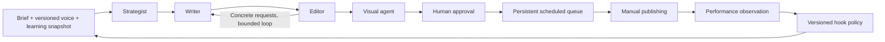

# CreatorOS

**A content studio that shows why the next post changed.**

CreatorOS helps technical creators turn a brief into an edited LinkedIn post or a developed newsletter, create a matching visual, queue it for publication, record engagement, and use that evidence to choose the next opening. The creator's voice stays anchored to multiple writing samples. Drafts, critiques, revisions, image versions, and learning decisions remain inspectable.

This is a local, single-user application built with FastAPI, React, SQLite, and LangGraph. Every live AI request—including brand extraction, editorial evaluation, and image generation—uses the mandatory [Mesh gateway](https://developers.meshapi.ai/). Demo content and synthetic engagement are visibly labeled.


[Watch the 90-second walkthrough](docs/demo.mp4). It uses actual application screenshots and labeled fixtures. It is not a real-time generation recording. Live Mesh outputs and measured checks are recorded separately in the evaluation reports.

## Quick start

Prerequisites: Python 3.11 or newer, Node.js 22 or newer, and a Mesh key for live AI generation. Fixture demos and deterministic checks work without paid AI calls.

```sh
python3 -m venv .venv
.venv/bin/python -m pip install -r requirements.txt -c constraints.txt
cp .env.example .env
npm --prefix frontend ci
npm --prefix frontend run build
.venv/bin/python -m uvicorn backend.creatoros.main:app --host 127.0.0.1 --port 8000
```

Open **http://127.0.0.1:8000**. Enter your Mesh key in the local `.env` before running live generation. Never paste it into a brief, commit it, or put it in frontend configuration.

```dotenv
MESH_API_KEY=rsk_your_key_here
MESH_BASE_URL=https://api.meshapi.ai/v1
MESH_CHAT_MODEL=openai/gpt-4o-mini
MESH_IMAGE_MODEL=openai/gpt-image-1-mini
CREATOROS_DATA_DIR=./data
CREATOROS_SEED_DEMO=true
```

Model availability and credit balance depend on the connected Mesh account. If a live request fails, the application preserves the error and completed work; synthetic output is never silently substituted for a failed paid call. The backend rejects an AI base URL outside Mesh.

The composer offers **Configured model**, **Budget** (`openai/gpt-4o-mini`), and **Submission-tested** (`openai/gpt-5.1`) choices. New runs freeze selected models, generation settings, platform, prompt hashes and output-schema hashes. Resume uses those settings; incompatible captured prompts or schemas stop before another paid call. Older runs disclose uncaptured schema coverage. A run cannot resume over later human edits, reviews, visual choices or publishing decisions. Preset selection is explicit because different models have different costs and behavior.

For frontend development, run the backend command above and `npm --prefix frontend run dev` in another terminal. Open **http://127.0.0.1:5173**; Vite proxies API and asset requests to the backend. The production backend serves the built frontend from `frontend/dist`.

## What to try

1. **Brand:** inspect the two labeled demonstration brands, or create a brand and provide at least three distinct writing samples. Extract a profile that cites those samples.
2. **Studio:** choose LinkedIn or newsletter, enter a brief, follow agent progress, and compare the original draft with the revision. Inspect all editor reviews and outstanding requests. Edit a passage and ask the editor to recheck the current version; an old review is marked stale after a human edit.
3. **Visual and queue:** create a visual, regenerate with feedback, or select a saved version. Explicit regeneration may spend Mesh credits; retrying a saved download preserves its request and model configuration. Approve the finished post and schedule it. When due, publish manually and confirm it in the studio.
4. **Learning:** record comparable metrics and the time they were measured. Recompute the learning snapshot, inspect its frozen observations, and generate another post. The learning chain connects actual previous and subsequent openings with the evidence and policy that changed them.

LinkedIn output stays within 3,000 characters. Newsletter output has a subject and a 400–700-word body with developed sections, an example, and an exercise. Both have copy/export controls. Newsletter adaptation does not imply an email-service integration or automated sending.

The seeded Ada and Milo brands, their posts, and their engagement are authored demonstrations. The working local installation also contains **eight authentic, source-attributed LinkedIn posts** from the creator's profile, with a voice profile extracted through Mesh. Those samples and the local database remain under ignored `data/`; they are not distributed with the repository.

The authenticated LinkedIn capture includes visible cumulative impressions and engagement where displayed. Its observation windows are unspecified, so these counts are retained as reference observations and **are not entered as 24-hour or 7-day feedback**. Public fixtures and authentic creator data remain distinguishable. A fresh checkout starts with the labeled demonstration brands; import your own samples through Brand or [the sample-import CLI](scripts/import_samples.py).

## How the agents cooperate



| Agent | Distinct responsibility | Inspectable output |
|---|---|---|
| Strategist | Choose audience, angle, outline, and an opening consistent with the frozen policy | Strategy, selected hook, supporting feedback |
| Writer | Draft using the brief and learned voice; address editor requests | Preserved draft and revision versions |
| Editor | Review brief fulfillment, specificity, clarity, voice, and unsupported claims | Concrete requests and review results |
| Visual | Translate the final draft into a matching image brief | Image prompt and local generated asset |

LangGraph coordinates named steps and persistent checkpoints. The application preserves completed step artifacts so a page refresh or ordinary retry does not regenerate finished work. A bounded editorial loop prevents runaway spending; unresolved issues remain visible for human review.

Voice profiles and learning snapshots are separate. A run freezes the versions it uses, allowing the content strategy to adapt without silently replacing a creator's voice. Decision events record concise explanations and linked evidence rather than hidden model reasoning. Read [the design note](docs/DESIGN.md) for the data flow and tradeoffs.

## What “learning” means

CreatorOS learns one narrow, inspectable preference: **problem-first**, **outcome-first**, or **question-first** openings.

```text
meaningful interactions per 1,000 impressions
    = 1,000 × (comments + reposts) / impressions
```

Counts are pooled by hook within the same brand, platform, provenance, and observation window. Missing or zero impressions are excluded. Each opening needs **at least three published posts and 300 total impressions**. A preference is used only when the leading opening's descriptive 90% post-level bootstrap range is above the others; ties and overlapping ranges keep the policy exploring. These thresholds are conservative product heuristics, not a guarantee of statistical significance. Every fourth usable or reserved draft explores an alternative; failed generation attempts do not advance the cadence.

Every learning update freezes the actual observations, source metadata, post openings, counts, and rates. Corrections append immutable feedback revisions while updating the active observation, so a correction does not inflate the sample count or rewrite older evidence. Legacy snapshots without preserved observations are labeled as aggregate-only rather than reconstructed from changed records.

For manually entered feedback, record `observed_at`. A 24-hour observation must be captured within one hour of its nominal window end; a 7-day observation has a six-hour tolerance. A later analytics report can declare an explicit start/end interval matching publication and the nominal window, with its later measurement time. Unknown, cumulative, mistimed, and unverified observations remain stored but are excluded from learning. These checks establish consistency of the creator's declaration, not independent verification of platform metrics. Collection reminders show when comparable feedback is due.

The next strategist run consumes its frozen snapshot. This is an explicit adaptive policy, not model fine-tuning or causal evidence of higher engagement. The UI displays counts, exclusions, descriptive ranges, and this limitation alongside the preference.

## Evaluation and recorded results

The evaluator provides a fast eight-pair smoke suite and a **fresh suite of 12 unseen briefs × two voices = 24 pairs**. Optional voice extraction learns both profiles from five authored samples each. Six blind voice comparisons exercise correct, swapped, and neutral profiles. These remain fictional voices; authentic creator samples stay private.

**Fresh benchmark:** 4/24 pairs were scored on the first attempt before a connection interruption; [transport-only recovery](evals/fresh-recovered/RESULTS.md) completed **23/24**. The original strategy-validation failure remains in the denominator. Across the 23 scored pairs, means were **4.817 → 4.913 / 5**, with **8 wins, 12 ties and 3 regressions**. The descriptive 95% paired interval for the change was **−0.0522 to +0.2435**, which includes zero. This does not establish a general quality improvement.

Exact word/format checks failed for **16 originals and 15 final drafts** out of 23 assessed pairs, despite high model scores. The two controlled feedback comparisons both changed the actual opening as intended, confirmed by a blinded opening classifier; policy reversal also passed. Those checks demonstrate adaptation, not audience uplift.

In the six blinded voice checks, both correct profiles were identified as their intended voices. Both swapped profiles were identified as the opposite voice supplied; neutral profiles matched the target in one of two cases. This supports a profile effect in these controlled examples, not general voice fidelity.

Live validation exposed newsletter, image-prompt and strategy-explanation length failures. Scoped fixes were then verified separately: a **630-word newsletter**, an initial visual and a regenerated visual, and a valid strategy explanation. [Targeted validation and actual Mesh images](evals/UPGRADE_VALIDATION.md) preserve all earlier failures. These later checks do not replace the benchmark or establish reliability across unseen cases. Free-form brief word limits remain a known weakness; visible word counts and manual editing help the creator review them.

**Preserved earlier result (GPT-5.1 through Mesh, four-dimension rubric):** 8/8 pairs completed after recovery, with mean scores **4.562 → 4.938 / 5**, **6 wins, 1 tie, and 1 regression**. First-attempt completion was **4/8**. The original report, failures, and [qualitative review](evals/REVIEW.md) remain unchanged. These numbers describe the earlier configuration, not a certification of the upgraded build.

Run the reproducible, free fixture checks into a separate output directory:

```sh
.venv/bin/python scripts/evaluate.py --output /tmp/creatoros-fixture-evaluation
```

Preview the bounded fresh benchmark without making AI calls:

```sh
MESH_CHAT_MODEL=openai/gpt-5.1 .venv/bin/python scripts/evaluate.py --live \
  --suite fresh --learn-voices --voice-checks --judge-model openai/gpt-4.1 \
  --max-generation-runs 34 --output evals/fresh --plan-only
```

Remove `--plan-only` to run it using Mesh credits. The cap bounds pipeline runs, not dollars: the preview also lists the maximum possible requests including schema correction. Existing live output directories are protected against accidental overwrite. Every completed stage of the benchmark checkpoints progress and keeps its private run workspace for interruption recovery.

The live judge scores **brief fulfillment, specificity, clarity, brand fit, and factual care** from 1–5. It can use a separately configured model from the writer through the same Mesh gateway; different models still have correlated preferences and biases. Candidate order is randomized and stage labels are hidden. Reports include explicit word/format constraint checks, per-dimension scores, descriptive paired bootstrap intervals, first-pass completion, failures, and retained regressions. The five-dimension composite is not directly comparable with the earlier four-dimension report. Model factual-care judgments are not external fact-checking.

A separate blinded call classifies only each feedback ablation's first sentence, retaining the exact sentence and rationale. A metadata change alone cannot pass this opening check. The voice judge sees anonymous reference samples and final prose, never the intended profile condition.

Reports include completion rate, every case, paired deltas, wins, ties, losses, and regressions. Quality averages are conditional on successful generation and judging; failed cases remain in the completion denominator. Failed run stages, partial drafts, and sanitized validation diagnostics are retained. Raw rejected provider responses stay in ignored local diagnostic files. Images are excluded to keep evaluation spending focused.

**Fresh first-attempt evidence:** [report](evals/fresh/RESULTS.md), [raw results](evals/fresh/results.json), [CSV](evals/fresh/results.csv), and [qualitative inspection of three pairs](evals/fresh/REVIEW.md). The first attempt includes a connection interruption, a strategy validation failure, and word-limit misses. Model scores must be read alongside those failures. Earlier results remain in [evals/RESULTS.md](evals/RESULTS.md). Fixture results report mechanics such as changed drafts; their quality scores are deliberately null. The script never manufactures scores when a live request fails. A fixture pass is not evidence that AI writing quality improved.

The [initial eight-pair live benchmark](evals/history/initial/RESULTS.md) scored **4.469 → 4.906 / 5**, with **7 wins, 1 tie, and 0 losses**. A stricter follow-up exposed generation failures and weaknesses in opening classification; [that report is preserved too](evals/history/strict-first/RESULTS.md). The initial score does not certify the upgraded build. Use the fresh reports to assess current completion and the stricter checks, including unresolved failures.

The [diagnostic mini-model run](evals/history/diagnostic-mini/RESULTS.md) retained three scored regressions and three generation failures. The [production model's first attempt](evals/history/production-first/RESULTS.md) completed four of eight pairs; the other four hit an unnecessarily restrictive 500-character limit on evidence notes. The limit now allows 1,200 characters while preserving content and rubric validation. These experiments changed model or validation configuration and are not a controlled comparison between model families.

Operational failures can be resumed from a compatible report's frozen inputs and completed artifacts, without rerolling successful drafts or judgments. Prompt/model/manifest changes are rejected. Use a separate output directory to retain the original report:

```sh
MESH_CHAT_MODEL=openai/gpt-5.1 .venv/bin/python scripts/evaluate.py --live \
  --resume-results evals/fresh/results.json --judge-model openai/gpt-4.1 \
  --retry-transport-only --output evals/fresh-recovered
```

Recovered reports retain first-attempt completion, previous errors, and separate recovery accounting. `--retry-transport-only` limits recovery to connection failures, timeouts, rate limits, and transient server errors, preserving schema failures as well as completed quality failures. A completed but unsuccessful quality or opening comparison is retained as evidence, not retried until it passes.

The benchmark is small and synthetic, model judging is subjective, and engagement is not a causal experiment. Review at least two pairs manually before presenting live quality claims. Record disagreements and retain regressions.

```sh
.venv/bin/python -m pip install -r requirements-dev.txt -c constraints.txt
PYTEST_DISABLE_PLUGIN_AUTOLOAD=1 .venv/bin/python -m pytest
.venv/bin/python scripts/check_submission.py
npm --prefix frontend run build
```

`check_submission.py` inspects local syntax, manifests, Mesh configuration, evaluation files, and basic secret hygiene. It cannot certify a valid Mesh key, GitHub repository visibility, or organizer CI.

The separate [CreatorOS test workflow](.github/workflows/tests.yml) builds the frontend and runs regression and fixture checks without an API key or paid calls. It leaves the committed live reports intact. `constraints.txt` records the direct Python package versions exercised locally; the frontend uses its committed npm lockfile.

## API and persistence

The interactive API schema is available at **http://127.0.0.1:8000/docs**. Generation creates a run immediately; the frontend polls persisted progress. Brands, samples, posts, draft versions, feedback observations, snapshots, and decision events live in SQLite under `CREATOROS_DATA_DIR`. Generated images are local assets in the same data directory.

Scheduling is durable: store UTC timestamps, display local time, and transition due approved posts into a ready state. This release uses manual LinkedIn publication and manually entered engagement. It does not include an automatic LinkedIn publisher, authentication, multi-user isolation, or a production deployment configuration. Keep the local service bound to `127.0.0.1`.

## Submission

The challenge requires a **public GitHub repository** and the organizer's unchanged workflow at `.github/workflows/agent-arena-2026-checks.yml`.

Configure these GitHub repository secrets under **Settings → Secrets and variables → Actions**:

- `MESH_API_KEY`: the Mesh key used by your checks.
- `SUBMISSION_TOKEN`: the registration token from your submission dashboard.

Push the submission commit and verify its Actions result and dashboard status. Local checks do not prove that a repository has been published or the organizer's remote checks passed. The repository must contain source, dependency manifests, this README, [design decisions](docs/DESIGN.md), and actual [evaluation results](evals/RESULTS.md). The [submission handoff](docs/SUBMISSION.md) maps each requirement to evidence and lists the remaining publication steps. [Demo materials](docs/DEMO.md) include the captioned walkthrough and a longer recording storyboard.
